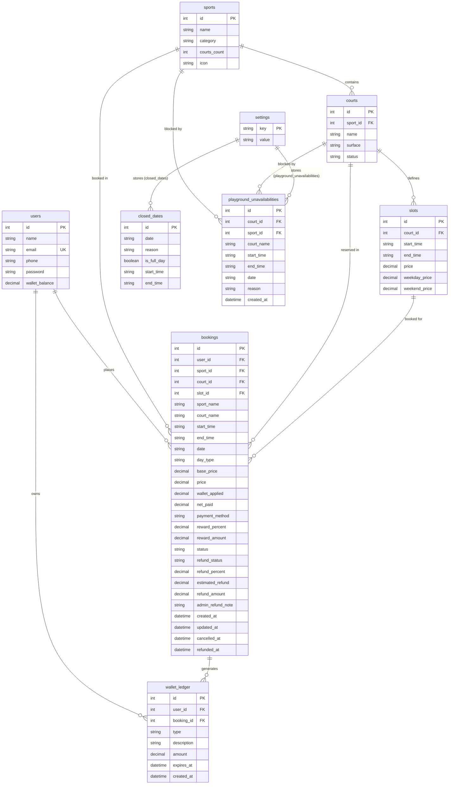

# Sports Slot Booking App — Database Design & ER Model

This document is generated from a full analysis of the application's IndexedDB layer (`SportsSlotWireframeDB`, version `1`) in [db_core.js](file:///d:/Project%20Office/wireFram/mobile_app/js/db/db_core.js) and its modular data services (`js/db/*.js`).

---

## 1. App Database Analysis

- **Database Engine (Current)**: Browser IndexedDB (`SportsSlotWireframeDB`, `DB_VERSION = 1`).
- **Physical Object Stores (7)**:
  1. `users`
  2. `sports`
  3. `courts`
  4. `slots`
  5. `bookings`
  6. `wallet_ledger`
  7. `settings` (Key-Value store holding scalar rules + 3 structured configuration objects: `facility_status`, `closed_dates`, and `playground_unavailabilities`)
- **Key Architectural Patterns Observed**:
  - **Double-Booking Prevention**: Checked in `createBooking()` and `updateBooking()` by matching `(court_id, slot_id, date)` where `status === "CONFIRMED"`.
  - **Day-Wise Pricing**: `slots` stores `price` (base), `weekday_price`, and `weekend_price` (defaults to `Math.round(price * 1.3)` when `weekend_price` is unset).
  - **Wallet & Reward Expiry**: `users.wallet_balance` caches the current balance, while `wallet_ledger` records every credit/debit (`WELCOME_BONUS`, `REWARD_EARNED`, `WALLET_PAYMENT`, `WALLET_UPGRADE_PAYMENT`, `WALLET_DOWNGRADE_REFUND`, `REWARD_ADJUST_ADD`, `REWARD_ADJUST_DEDUCT`, `REWARD_REVERSED`, `ADMIN_MANUAL_REFUND`) with `expires_at` on earned/refunded credits.
  - **Denormalized Snapshots on `bookings`**: Stores `sport_name`, `court_name`, `start_time`, `end_time`, `day_type`, `base_price`, `reward_percent`, and `reward_amount` at booking time so historical reservations remain accurate even if admin updates prices or names later.

---

## 2. All Tables List

| # | Table / Store Name | Storage Type | Primary Key | Description |
| :--- | :--- | :--- | :--- | :--- |
| 1 | `users` | Object Store | `id` (autoIncrement) | Registered players, auth credentials, and cached wallet balance |
| 2 | `sports` | Object Store | `id` (autoIncrement) | Sport categories (Table Tennis, Badminton, Tennis, Squash, Football) |
| 3 | `courts` | Object Store | `id` (autoIncrement) | Courts / tables / grounds belonging to a sport |
| 4 | `slots` | Object Store | `id` (autoIncrement) | Hourly time slots & day-wise pricing per court |
| 5 | `bookings` | Object Store | `id` (autoIncrement) | Slot reservations, payments, cancellations, and manual refunds |
| 6 | `wallet_ledger` | Object Store | `id` (autoIncrement) | Immutable wallet & cashback reward transaction history with expiry |
| 7 | `settings` | Object Store | `key` (string) | System rules (cutoffs, reward rate, expiry, discount cap, UPI ID) |
| 8 | `closed_dates` *(logical)* | Embedded in `settings` (`key="closed_dates"`) | `id` | Date-specific full-day or partial-day facility blackouts |
| 9 | `playground_unavailabilities` *(logical)* | Embedded in `settings` (`key="playground_unavailabilities"`) | `id` | Recurring or date-specific court/sport/facility time-window blocks |

---

## 3. Detailed Table Schemas & Input Fields

### 1. `users`
*Indexes*: `email` (`unique: true`)

| Field Name | Type | Constraints / Default | Input / Usage Mapping |
| :--- | :--- | :--- | :--- |
| `id` | `INTEGER` | **PK**, Auto Increment | Unique user ID |
| `name` | `STRING` | `NOT NULL` | Register: Full Name (`#reg-name`) |
| `email` | `STRING` | `UNIQUE, NOT NULL` | Login / Register: Email (`#login-email`, `#reg-email`) |
| `phone` | `STRING` | Optional (`""`) | Login / Register: Phone Number (`#reg-phone`) |
| `password` | `STRING` | `NOT NULL` | Login / Register: Password (`#login-password`, `#reg-password`) |
| `wallet_balance` | `DECIMAL(10,2)` | Default `10.00` on register (`15.00` for seed user) | Current reward/wallet balance (User Wallet & Admin Users list) |

---

### 2. `sports`

| Field Name | Type | Constraints / Default | Input / Usage Mapping |
| :--- | :--- | :--- | :--- |
| `id` | `INTEGER` | **PK**, Auto Increment | Unique sport ID |
| `name` | `STRING` | `NOT NULL` | Admin Manage Sports: Sport / Game Name |
| `category` | `STRING` | Default `"Indoor"` (`"Indoor"` / `"Outdoor"`) | Admin Manage Sports: Environment Category |
| `courts_count` | `INTEGER` | Default `2` | Admin Manage Sports: Number of Courts / Tables |
| `icon` | `STRING` | Default `"SP"` | Admin Manage Sports: Sport Icon Tag (e.g., `TT`, `BD`, `TN`, `SQ`, `FB`) |

---

### 3. `courts`
*Indexes*: `sport_id` (`unique: false`)

| Field Name | Type | Constraints / Default | Input / Usage Mapping |
| :--- | :--- | :--- | :--- |
| `id` | `INTEGER` | **PK**, Auto Increment | Unique court/table/ground ID |
| `sport_id` | `INTEGER` | **FK → `sports.id`**, `NOT NULL` | Parent sport |
| `name` | `STRING` | `NOT NULL` | Court name (e.g., `Badminton Court A`, `Table 1 (Pro Stiga Arena)`) |
| `surface` | `STRING` | Default `"Standard Court"` | Surface type (e.g., `Olympic Hardwood`, `Artificial Turf`) |
| `status` | `STRING` | Default `"Active"` | Court operational status |

---

### 4. `slots`
*Indexes*: `court_id` (`unique: false`)

| Field Name | Type | Constraints / Default | Input / Usage Mapping |
| :--- | :--- | :--- | :--- |
| `id` | `INTEGER` | **PK**, Auto Increment | Unique slot ID |
| `court_id` | `INTEGER` | **FK → `courts.id`**, `NOT NULL` | Target court |
| `start_time` | `STRING` (`HH:mm`) | `NOT NULL` | Slot start time (e.g., `"08:00"`) |
| `end_time` | `STRING` (`HH:mm`) | `NOT NULL` | Slot end time (e.g., `"09:00"`) |
| `price` | `DECIMAL(10,2)` | `NOT NULL` | Default / All-days rate (₹) |
| `weekday_price` | `DECIMAL(10,2)` | Optional (`null` → falls back to `price`) | Admin Slot Pricing: `WEEKDAY` rate (₹) |
| `weekend_price` | `DECIMAL(10,2)` | Optional (`null` → falls back to `round(price * 1.3)`) | Admin Slot Pricing: `WEEKEND` rate (₹) |

---

### 5. `bookings`
*Indexes*: `user_id` (`unique: false`), `slot_court_date` (`[court_id, date, slot_id]`, `unique: false`)

| Field Name | Type | Constraints / Default | Input / Usage Mapping |
| :--- | :--- | :--- | :--- |
| `id` | `INTEGER` | **PK**, Auto Increment | Unique booking ID |
| `user_id` | `INTEGER` | **FK → `users.id`**, `NOT NULL` | Player who owns the booking |
| `sport_id` | `INTEGER` | **FK → `sports.id`**, `NOT NULL` | Selected sport |
| `sport_name` | `STRING` | `NOT NULL` | Snapshot of sport name |
| `court_id` | `INTEGER` | **FK → `courts.id`**, `NOT NULL` | Selected court |
| `court_name` | `STRING` | `NOT NULL` | Snapshot of court name |
| `slot_id` | `INTEGER` | **FK → `slots.id`**, `NOT NULL` | Selected hourly slot |
| `start_time` | `STRING` (`HH:mm`) | `NOT NULL` | Snapshot of slot start time |
| `end_time` | `STRING` (`HH:mm`) | `NOT NULL` | Snapshot of slot end time |
| `date` | `STRING` (`YYYY-MM-DD`) | `NOT NULL` | Selected booking date |
| `day_type` | `STRING` | `"WEEKDAY"` \| `"WEEKEND"` | Resolved day schedule |
| `base_price` | `DECIMAL(10,2)` | `NOT NULL` | Base slot price before wallet deduction |
| `price` | `DECIMAL(10,2)` | `NOT NULL` | Active slot price (updated on reschedule) |
| `wallet_applied` | `DECIMAL(10,2)` | Default `0.00` | Reward points / wallet balance used |
| `net_paid` | `DECIMAL(10,2)` | `NOT NULL` | `price - wallet_applied` |
| `payment_method` | `STRING` | `"UPI"` \| `"COD"` \| `"WALLET"` | Checkout payment method |
| `reward_percent` | `DECIMAL(5,2)` | `NOT NULL` | Snapshot of `reward_percent` at booking |
| `reward_amount` | `DECIMAL(10,2)` | `NOT NULL` | Cashback reward earned |
| `status` | `STRING` | `"CONFIRMED"` \| `"CANCELLED"` \| `"RESCHEDULED"` | Booking status |
| `created_at` | `ISO_TIMESTAMP` | `NOT NULL` | Booking creation time |
| `updated_at` | `ISO_TIMESTAMP` | Nullable | Last reschedule timestamp |
| `cancelled_at` | `ISO_TIMESTAMP` | Nullable | Cancellation timestamp |
| `hours_before_slot` | `DECIMAL(6,1)` | Nullable | Notice hours remaining when cancelled |
| `refund_status` | `STRING` | Nullable (`"PENDING"` \| `"REFUNDED"`) | Admin Bookings & Refunds filter |
| `refund_percent` | `DECIMAL(5,2)` | Nullable | Applied `default_refund_percent` |
| `estimated_refund` | `DECIMAL(10,2)` | Nullable | Policy-calculated refund amount |
| `refund_amount` | `DECIMAL(10,2)` | Nullable | Final refund amount disbursed by admin |
| `admin_refund_note` | `STRING` | Nullable | Optional note entered by admin during refund |
| `refunded_at` | `ISO_TIMESTAMP` | Nullable | Timestamp when admin disbursed refund |

---

### 6. `wallet_ledger`
*Indexes*: `user_id` (`unique: false`)

| Field Name | Type | Constraints / Default | Input / Usage Mapping |
| :--- | :--- | :--- | :--- |
| `id` | `INTEGER` | **PK**, Auto Increment | Unique ledger entry ID |
| `user_id` | `INTEGER` | **FK → `users.id`**, `NOT NULL` | Wallet owner |
| `booking_id` | `INTEGER` | **FK → `bookings.id`**, Nullable | Related booking (`null` for `WELCOME_BONUS`) |
| `type` | `STRING` | `NOT NULL` | `WELCOME_BONUS`, `REWARD_EARNED`, `WALLET_PAYMENT`, `WALLET_UPGRADE_PAYMENT`, `WALLET_DOWNGRADE_REFUND`, `REWARD_ADJUST_ADD`, `REWARD_ADJUST_DEDUCT`, `REWARD_REVERSED`, `ADMIN_MANUAL_REFUND` |
| `description` | `STRING` | `NOT NULL` | Display description in Wallet History |
| `amount` | `DECIMAL(10,2)` | `NOT NULL` | Positive (`+`) for credit, negative (`-`) for debit |
| `expires_at` | `ISO_TIMESTAMP` | Nullable | Expiry date (`created_at + reward_expiry_days`) |
| `created_at` | `ISO_TIMESTAMP` | `NOT NULL` | Transaction timestamp |

---

### 7. `settings` (Admin Rules & Configuration Store)

| `key` (PK) | Value Field(s) | Default | Admin Rules & Availability Mapping |
| :--- | :--- | :--- | :--- |
| `reward_percent` | `value` (`NUMBER`) | `10` | Cashback Reward Policy: Reward Rate Percentage (X%) |
| `cancellation_cutoff_hours` | `value` (`NUMBER`) | `12` | Slot Cancellation Cutoff Policy (Hours Before Slot) |
| `reschedule_cutoff_hours` | `value` (`NUMBER`) | `0` | Slot Change / Reschedule Cutoff Policy (Hours Before Slot) |
| `default_refund_percent` | `value` (`NUMBER`) | `100` | Default Cancellation Refund Rate (% of Slot Fee) |
| `wallet_upgrade_ratio` | `value` (`NUMBER`) | `100` | Slot Upgrade Wallet Payment Ratio: Max Wallet Deduction Ratio (%) |
| `reward_expiry_days` | `value` (`NUMBER`) | `60` | Reward Cashback Expiry Policy: Reward Validity Period (Days) |
| `max_discount_percent` | `value` (`NUMBER`) | `30` | Maximum Limit of Discount: Highest Discount Cap Percentage (%) |
| `admin_upi_id` | `value` (`STRING`) | `"gyananiharish@ybl"` | Facility Payment UPI ID: Admin Receiving UPI ID |
| `facility_status` | `isOpen` (`BOOLEAN`), `reason` (`STRING`) | `true`, `"Normal Operations"` | Today's open/closed toggle |
| `closed_dates` | `dates` (`ARRAY<Object>`) | `[]` | See logical table **#8 (`closed_dates`)** below |
| `playground_unavailabilities` | `list` (`ARRAY<Object>`) | 2 seeded rules | See logical table **#9 (`playground_unavailabilities`)** below |

---

### 8. `closed_dates` *(Logical Table stored in `settings["closed_dates"].dates`)*

| Field Name | Type | Constraints / Default | Input / Usage Mapping |
| :--- | :--- | :--- | :--- |
| `id` | `INTEGER` | **PK** (`Date.now() + rand`) | Unique blackout ID |
| `date` | `STRING` (`YYYY-MM-DD`) | `NOT NULL` | Closed Dates & Blackouts: Date input |
| `reason` | `STRING` | Default `"Facility Closed"` | Closed Dates & Blackouts: Reason input |
| `is_full_day` | `BOOLEAN` | Default `true` | Closed Dates & Blackouts: Full Day Closure checkbox |
| `start_time` | `STRING` (`HH:mm`) | `"00:00"` (or `"10:00"` partial) | Partial closure start (e.g., `10 AM - 2 PM` preset) |
| `end_time` | `STRING` (`HH:mm`) | `"24:00"` (or `"14:00"` partial) | Partial closure end |

---

### 9. `playground_unavailabilities` *(Logical Table stored in `settings["playground_unavailabilities"].list`)*

| Field Name | Type | Constraints / Default | Input / Usage Mapping |
| :--- | :--- | :--- | :--- |
| `id` | `INTEGER` | **PK** | Unique unavailability rule ID |
| `court_id` | `INTEGER` | **FK → `courts.id`** (`0` = All/Sport-wide) | Ground & Academy Unavailability: Select Ground |
| `sport_id` | `INTEGER` | **FK → `sports.id`** (`0` = All Sports) | Optional sport-wide filter |
| `court_name` | `STRING` | `NOT NULL` | Display label (e.g., `"All Academy Grounds"`) |
| `start_time` | `STRING` (`HH:mm`) | Default `"10:00"` | Ground & Academy Unavailability: Start Time |
| `end_time` | `STRING` (`HH:mm`) | Default `"17:00"` | Ground & Academy Unavailability: End Time |
| `date` | `STRING` | `"ALL_DAYS"` or `"YYYY-MM-DD"` | Ground & Academy Unavailability: Date Schedule / Frequency |
| `reason` | `STRING` | Default `"Academy Training (10 AM - 5 PM)"` | Ground & Academy Unavailability: Reason / Activity |
| `created_at` | `ISO_TIMESTAMP` | `NOT NULL` | Rule creation timestamp |

---

## 4. Entity-Relationship (ER) Diagram

